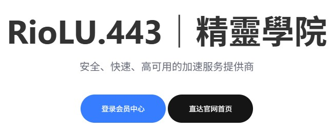

# Riolu 443精灵学院机场官网最新入口发布

Riolu 443 精灵学院（简称精灵机场）是一家提供网络代理订阅服务的机场平台，同时提供卷毛鼠 EMBY 影音服务。本文整理精灵机场最新官网地址、快捷访问入口、套餐流量规则及客户端使用说明，方便新老用户收藏访问。

**精灵机场官网域名已更新，建议收藏本文及下方快捷跳转地址，以免后续域名调整导致无法访问。**

## 一、精灵机场官网最新地址

| 项目 | 地址 |
|---|---|
| 最新官网 | [https://app.rioluiii.link](https://app.rioluiii.link/register?aff=yffpOMZq) |
| 快捷跳转页 | [https://ok.riolu.work](https://ok.riolu.work/register?aff=yffpOMZq) |
| 注册入口 | [点击进入精灵机场注册页面](https://ok.riolu.work/register?aff=yffpOMZq) |
| 客服邮箱 | juzimao2333@gmail.com |

**特别提醒：** 官网域名可能发生调整，建议优先收藏快捷跳转页：https://ok.riolu.work，后续如果官网更换域名，可以通过该页面寻找最新入口。

## 二、精灵机场介绍

精灵机场提供常规代理节点及高倍率节点，用户可以根据自己的网络需求和流量预算选择合适的线路。

[**点击进入精灵机场官网注册，了解套餐详情**](https://ok.riolu.work/register?aff=yffpOMZq)

### 节点倍率说明

精灵机场的节点采用不同流量倍率计费：

- **普通节点：** 统一为 1 倍流量费率。
- **高倍 3x 节点：** 按照 3 倍流量费率扣除流量。

为了避免普通节点用户误选高倍率线路，所有标注为「高倍 3x」的节点均已统一放在节点列表最下方。

如果对节点速度有较高要求，并且能够接受更高的流量消耗，可以尝试高倍 3x 节点；日常使用建议优先选择普通节点。

## 三、客户端使用建议

目前部分情况下，小火箭（Shadowrocket）客户端似乎存在兼容性问题。

如果遇到连接异常、节点无法正常使用等情况，可以考虑更换 **Karing** 客户端。

另外，精灵机场已经关闭节点自动测速功能。如有测速需求，需要手动点击测速。

**测速注意事项：**
- 不建议频繁进行批量测速。
- 如果测速后出现频繁断连，可以尝试刷新订阅。
- 刷新订阅后建议直接使用节点，不要反复批量测速。

## 四、订阅分流规则优化

精灵机场支持通过订阅参数配置更好的分流规则。

在订阅链接末尾添加以下参数：

`&remote=1`

即可配置更好的分流规则。

请注意保留原有订阅链接内容，只在末尾追加参数。

## 五、套餐流量与重置说明

这里有几个比较容易弄错的地方，购买套餐或流量包之前建议先看一下。

**1. 套餐流量提前用完怎么办？**

如果套餐还没有到期，但是当月流量已经用完，可以登录官网，在首页找到 **「重置流量」**，购买流量重置包。

注意：这种情况不要直接点击续费，续费和重置流量是两种不同的操作。

**2. 续费后流量没有增加怎么办？**

如果续费后流量没有正常增加，或者购买流量包后使用时间没有增加，可以前往官网的 **「我的工单」** 提交问题，说明订单及具体情况。

官方说明客服将在 8 小时内处理，但下午不处理工单。

如果比较着急，可以先购买重置包解决使用问题，之后等待客服上线处理，并将相关款项退回到本站余额。

## 六、Emby 影音服务

精灵机场还提供卷毛鼠 EMBY 服务。

如果需要使用 EMBY 影音服务，可以参考官方提供的 Emby 教程进行配置和操作。具体使用方法以官网教程及服务说明为准。

## 七、客服与售后

使用过程中如果遇到订阅、节点连接、套餐流量或订单问题，可以通过以下渠道联系官方：

- **网页客服：** 全天在线网页客服
- **官网工单：** 登录官网进入「我的工单」提交问题
- **客服邮箱：** juzimao2333@gmail.com

建议涉及订单、续费、流量重置等问题时，优先通过官网工单反馈，方便客服核对订单信息。

---

## 八、精灵机场官网入口汇总

**最新官网：** https://app.rioluiii.link

**快捷跳转：** https://ok.riolu.work

**优惠注册链接：** https://ok.riolu.work/register?aff=yffpOMZq

域名可能调整，建议收藏快捷跳转页，避免官网更换入口后找不到访问地址。

*本文主要整理 Riolu 443 精灵学院机场的官网入口、节点倍率、客户端及套餐使用说明，相关服务和套餐信息以官方网站实际公布为准。*
